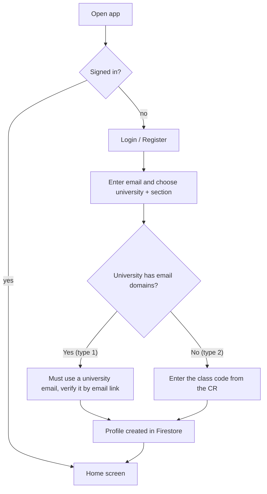
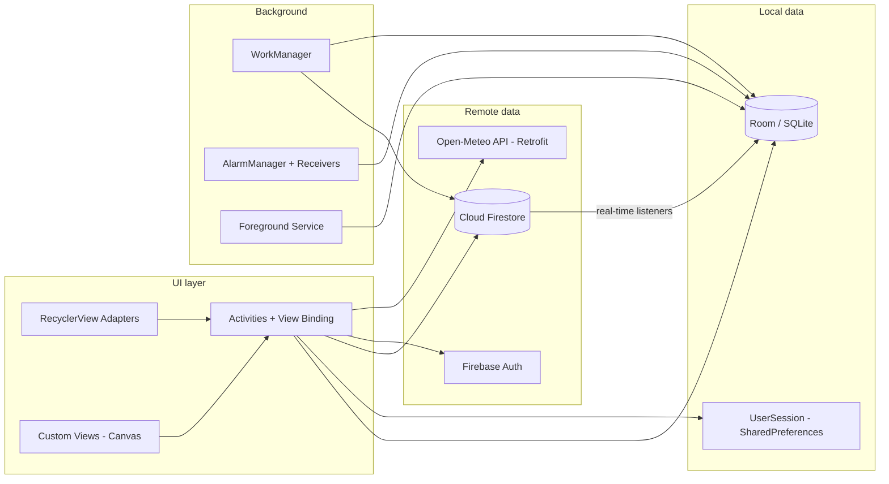

<div align="center">

# 🎓 Campus Companion

**A student life manager for Android: deadlines, class routine, study plan and class notices, all in one app.**


-003B57?logo=sqlite&logoColor=white)


*Advanced Programming Laboratory (2026) · Individual Android Studio Project*
**Khalid Bin Atik** · Khulna University of Engineering & Technology (KUET)

</div>

---

## 📑 Table of contents

1. [Overview](#-overview)
2. [Lab syllabus coverage](#-lab-syllabus-coverage)
3. [Features](#-features)
4. [How it works](#-how-it-works)
5. [Architecture](#-architecture)
6. [Tech stack](#-tech-stack)
7. [Project structure](#-project-structure)
8. [Data model](#-data-model)
9. [Security](#-security)
10. [Setup and run](#-setup-and-run)
11. [Version control](#-version-control)

---

## 🌟 Overview

University students juggle assignment deadlines, a weekly class routine, personal study time and notices from their class representative (CR). **Campus Companion** brings these together in one offline-first app:

- Deadlines, routine and study plans are stored **on the phone** (Room / SQLite), so everything works without internet.
- A **class representative** can post notices and shared deadlines to their whole section in real time through **Firebase**.
- Every university and section is kept **separate**, so students only ever see their own class.
- Reminders, a persistent tracker notification and a home-screen widget keep important dates in front of the student.

---

## ✅ Lab syllabus coverage

This project was built for the Android part of the course plan (Weeks 8–13). The table shows where each topic is used in the code.

| Week | Topic | Where it is implemented in Campus Companion |
|:---:|---|---|
| **2** | Git and version control | GitHub repository with many small commits across the whole development (see [Version control](#-version-control)). |
| **4** | Multithreading and concurrency | `ExecutorService` for database writes (`AppDatabase.executor`), `goAsync()` + background thread in receivers, `WorkManager` background sync, Retrofit asynchronous calls, Firestore real-time listeners. |
| **6** | Relational database (SQLite) | **Room** over SQLite: 3 tables (`deadlines`, `routine`, `study_sessions`), DAOs with queries, a schema **migration** (v1 → v2), one database per signed-in account. |
| **7** | JSON parsing and API responses | **Retrofit + Gson** call the Open-Meteo weather API and convert the JSON response into Java objects (`WeatherResponse`). |
| **8** | Android Studio basics | Multi-activity app, `AndroidManifest`, Gradle, XML layouts, **View Binding**, click listeners, **explicit Intents** between screens, **implicit Intent** (share class code), Activity lifecycle (`onStart` / `onStop` listener handling). |
| **9** | UI, RecyclerView, custom views, UX | `RecyclerView` with 4 adapters and custom item layouts, **5 custom `View` classes drawn with Canvas**, Material 3 design, dark mode, splash screen. |
| **10** | Services, Broadcast Receivers, Content Providers | Foreground **Service**, 3 **Broadcast Receivers** (+ widget provider), and a **Content Provider** exposing deadlines through a `content://` URI. |
| **11** | Networking, data handling, advanced APIs, Firebase | Retrofit networking, **Firebase Authentication**, **Cloud Firestore**, Google and Facebook sign-in, location (GPS), `AlarmManager`, notifications, `WorkManager`. |
| **13** | Project demonstration | Final demo: architecture, UI, data flow and design decisions are explained in this README. |

> Weeks 1, 3 and 5 are covered by the Java and JavaFX parts of the course, not by this Android project.

---

## ✨ Features

### 📚 Student tools (work offline)

| Feature | What it does |
|---|---|
| ⏰ **Deadlines** | Add deadlines with course, note, priority (High / Medium / Low), due date and time. Mark them done, or delete them with a long press. A live **countdown view** shows the time left. |
| 🔔 **Smart reminders** | Each deadline can remind you X minutes before it is due, using exact alarms. Reminders **survive a phone restart**. |
| 📚 **Class routine** | Weekly university classes with room and teacher. Today's classes show on the home screen. |
| 🕒 **Class timetable** | A weekly grid (days across, hours down) drawn with a custom Canvas view. |
| 📖 **My study plan** | Personal study sessions with subject, topic, days of the week, time and reminder. Sessions can be edited, switched on or off, or deleted. Kept separate from university classes (teal colour) so they never get mixed up. |
| 📊 **Deadline statistics** | Completion donut chart, a bar chart of deadlines due in the next 7 days, and a priority breakdown. |
| 📅 **Deadline calendar** | A month calendar marking days that have deadlines. |
| 📌 **Persistent tracker** | Optional foreground notification that always shows the next unfinished deadline. |
| 🧩 **Home-screen widget** | Next deadline, time left, overdue count and today's classes at a glance. |
| 🌤️ **Weather** | Current weather for the student's location (GPS), with a fallback city if permission is denied. |
| 🌙 **Dark mode** | Light and dark themes, saved across launches. |

### 👥 Class features (Firebase, real time)

| Feature | What it does |
|---|---|
| 📢 **Class notices** | The CR posts notices to the section. Students get them instantly with a notification. |
| 📣 **Shared deadlines** | The CR posts a deadline once and it appears for the whole section. Students keep their own "done" tick. |
| 🏫 **University + section separation** | Each class has its own private space. A student from another section or another university never sees it. |
| 🔑 **Two ways to join** | **Type 1:** universities with student email: sign up with the verified university email (for example KUET). **Type 2:** universities without student email: sign up with any email plus a **class code** from the CR. |
| 🔐 **Sign-in options** | Email and password (with email verification for university email), **Google** and **Facebook**. |
| 🗝️ **Class code sharing** | The CR can view, share (WhatsApp and similar) and reset the class code from the Notices screen. |

---

## ⚙️ How it works

### 1. Signing up and joining a class



- The profile stores `university`, `section` and a **`groupId`** (for example `KUET_CSE_105_B`). The `groupId` is the key that separates every class.
- Social logins (Google, Facebook) ask for the same details on a "One last step" screen. Facebook cannot prove a university email, so Facebook users join through the class-code route.
- The CR role is given by the admin in the Firebase console, so a student cannot make themselves a CR.

### 2. Notices and shared deadlines

```text
CR posts  ──►  Firestore: sections/{groupId}/notices        ──►  Listener on every
               Firestore: sections/{groupId}/deadlines            student's phone
                                                                        │
                                                       Home card + notification + local DB
```

- Students listen only to `sections/<their groupId>/...`, so other classes are never fetched.
- A **WorkManager** job syncs every 15 minutes as a fallback, even when the app is closed.
- Shared deadlines are copied into the local Room database, so they work offline and can use the same reminders as personal deadlines.

### 3. Reminders

1. Saving a deadline stores it in Room (on a background thread).
2. `ReminderScheduler` sets an exact alarm with `AlarmManager`.
3. At the time, `ReminderReceiver` wakes up, reads the deadline in the background (`goAsync()`) and shows a notification.
4. After a reboot, `BootReceiver` re-creates all alarms from the database.

### 4. Android components in action

| Component | Class | Purpose |
|---|---|---|
| **Service** | `NextDeadlineService` | Foreground service that watches the database (LiveData) and keeps a notification with the next deadline. |
| **Broadcast Receiver** | `ReminderReceiver` | Shows a deadline reminder when an alarm fires. |
| **Broadcast Receiver** | `StudyReminderReceiver` | Same for study sessions. |
| **Broadcast Receiver** | `BootReceiver` | Re-schedules alarms after the phone restarts. |
| **App Widget** | `NextDeadlineWidget` | Home-screen widget that refreshes when data changes. |
| **Content Provider** | `DeadlineProvider` | Exposes deadlines at `content://com.example.campuscompanion.provider/deadlines` (query, insert, update, delete). |
| **Worker** | `SyncWorker` | Periodic background sync of shared deadlines. |

---

## 🏗️ Architecture



**Design decisions**

- **Offline-first:** the UI reads from Room using `LiveData`, so screens update automatically when data changes and work without internet.
- **One database per account:** the database file name includes the user id, so two accounts on one phone never see each other's data.
- **Single write executor:** Room writes go through one `ExecutorService`, which keeps the main thread free and writes in order.
- **Group id as the separator:** `university + section` is the one key for all class data, which keeps queries and security rules simple.
- **Colour-coded features:** each feature has its own accent colour, and the study plan (teal) is never confused with university classes (purple).

---

## 🧰 Tech stack

| Area | Technology |
|---|---|
| Language | Java 8, XML |
| IDE / build | Android Studio, Gradle |
| UI | Material 3, View Binding, RecyclerView, ConstraintLayout, custom Canvas views, Splash Screen API |
| Local database | Room 2.6 (SQLite), LiveData |
| Networking | Retrofit 2.9, OkHttp, Gson (JSON) |
| Background work | WorkManager, AlarmManager, Foreground Service, Broadcast Receivers |
| Backend | Firebase Authentication, Cloud Firestore |
| Sign-in | Email/password, Google (Credential Manager), Facebook Login |
| Location | Google Play Services Fused Location |
| Min / target SDK | 24 / 34 |

---

## 🗂️ Project structure

```text
app/src/main/java/com/example/campuscompanion/
├── MainActivity.java            Home screen (greeting, weather, notice, classes, study plan)
├── CampusApp.java               Application class (applies saved dark/light mode)
├── auth/        UserSession     Cached profile: name, university, section, role
├── model/       Notice, University
├── data/
│   ├── local/   Room: AppDatabase, Deadline, RoutineEntry, StudySession + DAOs
│   └── remote/  Retrofit: WeatherApi, WeatherClient, WeatherResponse
├── ui/          Login, Register, VerifyEmail, CompleteProfile, Deadlines, AddDeadline,
│                Routine, AddRoutine, Timetable, Study, AddStudy, Stats, Calendar, Notices
├── adapter/     DeadlineAdapter, RoutineAdapter, StudyAdapter, NoticeAdapter
├── view/        Custom views: TimetableView, MonthCalendarView, DonutChartView,
│                BarChartView, DeadlineCountdownView
├── sync/        SyncManager, SyncWorker, NoticeManager, DeadlineAlerts (Firestore sync)
├── reminder/    ReminderScheduler, StudyReminderScheduler (AlarmManager)
├── receiver/    ReminderReceiver, StudyReminderReceiver, BootReceiver
├── service/     NextDeadlineService (foreground)
├── provider/    DeadlineProvider (content provider)
├── widget/      NextDeadlineWidget
└── notification/ NotificationHelper (channels + notifications)
```

---

## 🧱 Data model

**Local (Room / SQLite)**

| Table | Main columns |
|---|---|
| `deadlines` | id, title, course, note, priority, dueAt, remindBeforeMinutes, done, isShared, remoteId |
| `routine` | id, course, room, teacher, dayOfWeek, startMinutes, endMinutes |
| `study_sessions` | id, subject, topic, daysMask, startMinutes, endMinutes, reminderMinutes, enabled |

**Cloud (Firestore)**

```text
universities/{code}           name, domains[], sections[], freeSections
users/{uid}                   name, email, university, section, groupId, role
sections/{groupId}            joinCode (for universities without student email)
sections/{groupId}/notices    message, author, createdBy, createdAt
sections/{groupId}/deadlines  title, course, note, priority, dueAt, createdBy
```

---

## 🔐 Security

Class separation is enforced on the **server** with Firestore security rules (`firestore.rules`), not only in the app:

- A user can read and write only inside `sections/{their own groupId}`.
- Only a **CR** of that class can post or delete notices and shared deadlines.
- Users cannot change their own `role`, `university`, `section` or `groupId` after signing up.
- **Type 1 universities:** the profile is accepted only if the email is verified and its domain belongs to that university.
- **Type 2 universities:** the profile is accepted only if the class code matches the section's code.
- Facebook sign-in is not trusted to prove a university email.
- Secret keys (`google-services.json`, Facebook keys) are not committed to the repository.

---

## 🚀 Setup and run

**Requirements:** Android Studio (recent), JDK 17, an Android phone or emulator (API 24+).

1. **Clone**
   ```bash
   git clone https://github.com/Khalid441/Campus-Companion.git
   ```
2. **Firebase:** create a Firebase project, add an Android app with package `com.example.campuscompanion`, enable **Authentication** (Email/Password, Google, Facebook) and **Cloud Firestore**, then download `google-services.json` into `app/`.
3. **Facebook keys:** create `app/src/main/res/values/facebook.xml`:
   ```xml
   <resources>
       <string name="facebook_app_id">YOUR_APP_ID</string>
       <string name="facebook_client_token">YOUR_CLIENT_TOKEN</string>
       <string name="fb_login_protocol_scheme">fbYOUR_APP_ID</string>
   </resources>
   ```
4. **Rules:** publish `firestore.rules` in the Firebase console.
5. **Add a university:** in Firestore create `universities/{code}` with `name`, `domains` (empty for class-code universities) and `sections`.
6. **Run:** open the project in Android Studio, sync Gradle and press **Run**. To install on another phone without Android Studio, use **Build > Build APK(s)** and share `app-debug.apk`.

---

## 🌿 Version control

The project was developed with Git and GitHub using small, meaningful commits (new features, UI changes, security fixes) rather than one final upload. Secret files are excluded through `.gitignore`.

---

<div align="center">

Built by **Khalid Bin Atik** for the Advanced Programming Laboratory course.

</div>
